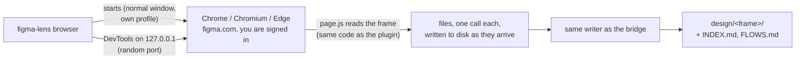

# figma-lens in the browser (no Figma desktop app)

`figma-lens browser` exports frames from **figma.com in your own Chrome, Chromium or Edge**. It works on **Linux**, macOS and Windows. You don't need the Figma desktop app, a plugin or any publishing. The output is the same `design/<frame>/` folder the desktop plugin writes, so the skill, `figma-lens check` and the component map work unchanged. It also exports the **prototype links** between screens (see [What gets exported](#what-gets-exported)).

## How it works



1. figma-lens starts your browser as a **normal window**, not an automated one. Google sign-in therefore works: automated Chrome windows get "This browser or app may not be secure".
2. The window uses **its own profile**, so you sign in to Figma **once** and the login is kept. Your everyday browser profile isn't touched.
3. The browser opens a DevTools port on **127.0.0.1 only**, picked at random. figma-lens connects to it, injects `plugin/dist/page.js` into the Figma tab (it reads the frame through the `figma` object on the figma.com page, with the same code as the desktop plugin), and the frames come back to figma-lens directly. Nothing goes over the network and no data leaves your machine.
4. The window **stays open** after figma-lens exits, so you can keep working. The next run reuses it.

## Linux setup (once per developer)

**1. Node 18+ and a Chromium-based browser.** Any of these:

| Distro | Recommended | Command |
|---|---|---|
| Ubuntu / Debian | Google Chrome (.deb) | `wget https://dl.google.com/linux/direct/google-chrome-stable_current_amd64.deb && sudo apt install ./google-chrome-stable_current_amd64.deb` |
| Fedora | Chromium | `sudo dnf install chromium` |
| Arch | Chromium | `sudo pacman -S chromium` |
| Any (Flatpak) | Chrome or Chromium | `flatpak install flathub com.google.Chrome` (or `org.chromium.Chromium`) |

Ubuntu's `chromium-browser` is a **Snap**. It works, but Snap can't write hidden folders such as `~/.figma-lens`, so figma-lens keeps the profile in `~/snap/chromium/common/figma-lens-profile` automatically. If you can choose, the Chrome `.deb` is the least trouble.

**2. figma-lens itself:**
```bash
git clone https://github.com/mramadan-cell/figma-lens && cd figma-lens
npm install && npm run build && npm link     # `figma-lens` is now a command
```
Node from Ubuntu's own packages: 24.04 has Node 18 (fine); **22.04 has Node 12, too old**: install Node 22 first (`curl -fsSL https://deb.nodesource.com/setup_22.x | sudo -E bash - && sudo apt install -y nodejs`). With Node from apt, `npm link` needs `sudo`.

**3. Check the setup.** Run this in your project folder:
```bash
figma-lens browser --doctor
```
Example output on Linux:
```
figma-lens browser: setup check
✔ system   linux 6.8.0
✔ config   /home/dev/my-app/figma-lens.config.json
✔ browser  /usr/bin/google-chrome-stable [regular] (from auto) · Google Chrome …
✔ profile  /home/dev/.figma-lens/browser-profile (from auto)
✔ out      /home/dev/my-app/design (from config)
✔ display  Wayland wayland-0
✔ bundle   /home/dev/figma-lens/plugin/dist/page.js
✔ window   not open (figma-lens browser starts it)

Ready. Run: figma-lens browser
```
Every `✖` line says how to fix it.

**4. First run:** `figma-lens browser`. figma-lens sees that the profile isn't signed in to Figma and opens the **sign-in window** by itself: sign in there (Google, email or SSO), check that your files show, then **close that window**. figma-lens then opens its own window, signed in. Needed only once per profile.

- **Why a separate sign-in window:** Google refuses to sign in while the browser's DevTools port (which figma-lens uses to read Figma) is open: *"This browser or app may not be secure"*. This happened in Google Chrome on Windows and in Chromium on Linux. The sign-in window has no DevTools port, so Google accepts it. `figma-lens browser --login` opens the same window by hand.
- **Figma says "WebGL isn't supported"** (WSL, virtual machines, remote desktops: no GPU the browser trusts): nothing to do. figma-lens checks WebGL when it opens the window; if it's off, it restarts the browser once with software graphics (`--ignore-gpu-blocklist`) and remembers that for the profile. You see `WebGL is off … Restarting it with software graphics` and then `✔ WebGL works now`. Exports are not affected; Figma itself just scrolls a bit slower.

Run it from a terminal **inside your desktop session** (X11 or Wayland). A plain SSH session has no display; figma-lens says so. Use `ssh -X` if you must work remotely.

## Your Figma account (and why there is no password setting)

**figma-lens never asks for, stores or sends your Figma password.** There is no `password` or `email` setting, on purpose: a password in a config file ends up in git, in backups and in screenshots.

- You sign in **in the browser window** figma-lens opens, the same way you sign in anywhere (Google, email + password, SSO, 2FA). Figma's own login page handles it.
- The login is kept as a **cookie in the figma-lens browser profile** (`~/.figma-lens/browser-profile` by default), like any browser keeps you signed in. The profile is a normal folder on your machine; it is never in the project and never in git.
- **Sign out:** sign out in that window, or delete the profile folder.
- **Each developer uses their own account.** The Figma file must be shared with that account (view access is enough; figma-lens only reads).
- **Two accounts** (for example work and a client's): one profile per account.
  ```bash
  figma-lens browser --profile ~/.figma-lens/client-profile     # or: export FIGMA_LENS_PROFILE=~/.figma-lens/client-profile
  ```
  Each profile has its own window and its own login.
- **Never commit a profile folder** and don't put `profile` in the shared config unless it uses `~` (each developer's own home).

## Your project: name the Figma links once

Put the project's Figma links in the shared config under `files`, with short names. Everyone then exports by name instead of hunting for links:

```json
{
  "browser": {
    "out": "design",
    "files": {
      "login":    "https://www.figma.com/design/AbC123/Shop-app?node-id=12-34",
      "home":     "https://www.figma.com/design/AbC123/Shop-app?node-id=12-80",
      "checkout": "https://www.figma.com/design/AbC123/Shop-app?node-id=40-2"
    }
  }
}
```

```bash
figma-lens browser login --once           # same as pasting the login link
figma-lens browser login --flow --once    # login and every screen it links to
```

In the interactive mode the names are listed, and typing a name + Enter exports it. Names may use letters, digits, `_`, `.` and `-`. Each link is checked when the config is read (it must be a figma.com design link). Get a link in Figma with right-click on a frame → *Copy link to selection*. A link without `?node-id=` exports the current selection in that file.

## Daily use

```bash
cd my-app
figma-lens browser
```
- In the browser window, open the design file, **select one or more frames**, then press **Enter** in the terminal. The terminal shows each frame and where it was written.
- Or **paste a Figma link** in the terminal and press Enter. With `?node-id=…` (Figma → right-click a frame → *Copy link to selection*), those frames are exported even if nothing is selected.
- Or type a **name** from `files` (see above), or `flow` (the selection and every screen it links to), or `flow <link or name>`.
- `q` + Enter quits. The window stays open.

One shot, for scripts or for Claude Code:
```bash
figma-lens browser "https://www.figma.com/design/<key>/<name>?node-id=12-34" --once
figma-lens browser --once        # exports the current selection, then exits
figma-lens browser login --flow --once --flow-max 10
```
Exit code 0 = everything exported, 1 = something failed (the reason is printed), 2 = setup error.

### What the terminal shows

Every screen, every step, with the time since that screen started:
```
Using the open figma-lens browser window (DevTools port 41837)
Figma Shop app · 1 frame(s) from the link · following prototype links (max 30 screens)
▶ [1] Login FRAME 12:34 · 390×844 · page "Mobile"
     0.0s  Reading "Login"…
     0.4s  Read 212 layers, 9 icon/image file(s)
     0.6s  Prototype: 4 link(s) → "Home", "Filter sheet", back, https://example.com/help
     1.5s  Rendering the frame preview…
✔ Login → design/login (212 layers, 23 files, 2.9s)
↪ following links to 2 more screen(s): "Home", "Filter sheet" (overlay)
▶ [2] Home FRAME 12:80 · 390×844 · page "Mobile"
…
■ 3 screen(s) exported in 8.4s → /home/dev/my-app/design
  screen map: /home/dev/my-app/design/FLOWS.md (3 screen(s), 3 link(s) between screens)
```

### Auto mode from the browser

`--auto` does what `figma-lens bridge --auto` does for the desktop plugin: after each export, Claude Code implements the screen (needs `"auto": { "enabled": true }` in the config; see the README's auto mode section).
```bash
figma-lens browser --auto              # interactive: every frame you export is implemented
figma-lens browser login --once --auto # one screen, then waits until Claude is done
```

## Configuration

One file for the whole team: **`figma-lens.config.json` in the project root**, the same file auto mode uses. Commit it so every developer gets the same output folder and options. Create the section with `figma-lens browser --init`.

```json
{
  "browser": {
    "executable": null,
    "profile": null,
    "out": "design",
    "scale": 2,
    "cssLimit": 3000,
    "maxLayers": 0,
    "flowMax": 30,
    "files": {},
    "args": []
  }
}
```

| Setting | Default | Meaning |
|---|---|---|
| `executable` | `null` = auto-detect | Browser to start. A path (`"/usr/bin/chromium"`), a command on PATH (`"google-chrome-stable"`), or a list for Flatpak: `["flatpak", "run", "com.google.Chrome"]`. Leave it `null` in the shared file and let each developer override it with `FIGMA_LENS_BROWSER` if needed. |
| `profile` | `null` = auto | Folder for the browser profile (your Figma login). Auto: `~/.figma-lens/browser-profile`; Snap Chromium `~/snap/chromium/common/figma-lens-profile`; Flatpak `~/.var/app/<app id>/figma-lens-profile`. `~` is expanded. **Don't commit a profile folder**: it holds your login. |
| `out` | `design` | Where exports go. Relative paths are relative to the config file. |
| `scale` | `2` | Frame preview scale: 1, 2, 3 or 4. |
| `cssLimit` | `3000` | Fetch Figma's CSS for at most this many layers (0 = all). |
| `maxLayers` | `0` | Stop after this many layers (0 = no limit); skipped layers are listed in spec.md. |
| `css` | `true` | Include Figma's CSS per layer in spec.json. |
| `sections` | `true` | Section crops (and per-section spec files for large frames). |
| `files` | `{}` | The project's Figma links by name (see [Your project](#your-project-name-the-figma-links-once)). |
| `flowMax` | `30` | With `--flow`: export at most this many screens in one run. `0` = no limit (each screen is still exported only once). |
| `args` | `[]` | Extra browser flags, e.g. `["--enable-unsafe-swiftshader"]`. figma-lens sets the profile and DevTools flags itself, so those are rejected. The software-graphics flag is added by itself when needed (see WebGL above). |
| `startUrl` | Figma recent files | The page the window opens on. |
| `startTimeoutSeconds` | `30` | How long to wait for the browser to start. |

Unknown settings or wrong types stop with a clear message (`unknown setting browser.exe`), so typos don't silently do nothing.

**Order of priority**, highest first. `--doctor` shows which one won for each setting:

1. **Command-line flags:** `--browser <path>`, `--profile <dir>`, `--out <dir>`, `--scale`, `--css-limit`, `--max-layers`, `--no-css`, `--flow-max`, `--map <file>`, `--config <file>` (and, not settings: `--once`, `--flow`, `--auto`, `--doctor`, `--init`, `--login`)
2. **Environment variables:** `FIGMA_LENS_BROWSER`, `FIGMA_LENS_PROFILE`, `FIGMA_LENS_OUT`, for per-developer differences such as `export FIGMA_LENS_BROWSER=/usr/bin/chromium` in `~/.bashrc`
3. **`figma-lens.config.json`** → `browser`, in the current folder or its parent
4. **Auto-detection.** Linux order: `google-chrome-stable`, `google-chrome`, `chromium`, `chromium-browser`, `microsoft-edge-stable`, `microsoft-edge`, Snap Chromium, then Flatpak Chrome, Chromium or Edge.

## What gets exported

Everything the desktop plugin exports (layer tree, auto layout, colors, text, tokens, icons, images, frame preview, section crops), plus the **relations between screens**:

- Under each layer with a prototype interaction, spec.md shows a line such as
  `→ on click: navigate to "Home" (`2:1`), push left 0.3s ease-out` or `→ on click: open overlay "Filter sheet" (`3:1`)`.
- spec.md has a **Prototype** section near the top: the flows this screen starts, whether it scrolls, and every link (layer → action → target).
- `spec.json` holds the same data in `reactions` for each layer. `meta.prototype` holds the page's flows (start screens), this screen's scroll and fixed-children settings, every link (`links`), and every link target with its name and page. Overlay settings (position, background, close on outside click) are recorded only for screens a link opens **as an overlay**, so a normal screen never looks like a modal.

Prototype times are shown in **seconds**, as Figma reports them.

## How the screens connect: FLOWS.md and `--flow`

After every export, figma-lens rewrites two files next to `INDEX.md`, from all the exports in the folder:

- **`FLOWS.md`** for Claude and people: the start screens (Figma flows), a table of screens with *goes to* / *comes from*, every link (screen, layer, trigger, action, target folder), the screens that are **linked but not exported yet** (with the exact command to export each one), and a Mermaid graph (solid arrow = navigate, dotted = overlay).
- **`flows.json`**, the same for tools.

Export a whole flow in one go:
```bash
figma-lens browser "https://www.figma.com/design/<key>/<name>?node-id=12-34" --flow --once
```
figma-lens exports the screen, reads its links, exports every screen they navigate to, swap to or open as an overlay, and so on, each screen once, up to `flowMax` screens (default 30, `--flow-max 10` to change it, `--flow-max 0` for no limit). Scroll-to links and links inside the same screen are not followed. A screen on another page of the file is loaded first (Figma's page loading).

If the design has no prototype links, FLOWS.md says so. Ask the designer to add them in Figma (Prototype tab) and Claude can wire the navigation from them.

## Is it as accurate as the desktop plugin? `figma-lens parity`

Compare two exports of the same frame, for example one from the desktop plugin and one from the browser:
```bash
figma-lens parity design-desktop/login design/login        # --json for the full report
```
It checks the frame info, every layer by id and every property (position, size, layout, fills, strokes, effects, text, variables, components, links), variables and styles, every icon and image **by content**, and the frame preview **pixel by pixel**. Exit code 0 = same, 1 = different.

Measured on a real 686-layer frame (1280×4288), desktop plugin vs browser: **686/686 layers with every property identical, 27/27 icons and images identical, preview 2560×8577 with 0% pixels different.** The only differences were from the figma-lens version (the newer one skips CSS for plain size boxes and icons; their size is in the spec anyway).

## Troubleshooting

| Message | Fix |
|---|---|
| `no Chrome, Chromium or Edge found` | Install one (table above) or set `executable` / `FIGMA_LENS_BROWSER`. |
| `no graphical display` | Run it in a terminal inside your desktop session, not over plain SSH. |
| `did not open its DevTools port within 30s` | A window that uses the same profile is already open but was started without figma-lens. Close it and run again. |
| `no Figma design file is open` | Open the file in the figma-lens window (not your everyday browser), select frames, press Enter. |
| `Figma's page API … is not available` | Reload the Figma tab and run again. If it keeps happening, Figma updated its page and figma-lens needs a matching update: use the desktop plugin until then. |
| Google says "This browser or app may not be secure" | You signed in in the figma-lens window (it has the DevTools port open). Close it and run `figma-lens browser` again: it opens the sign-in window (no DevTools port) by itself. Or run `figma-lens browser --login`. |
| Figma says "WebGL isn't supported" | figma-lens fixes this when it opens the window itself. If the window was already open, close every window of that browser (`pkill chromium` / `pkill chrome`) and run `figma-lens browser` again. If it says WebGL is off even with `--ignore-gpu-blocklist`, add `"args": ["--enable-unsafe-swiftshader"]` to the `browser` section. |
| `--login` waits and never returns | It waits until every window of that browser profile is closed. Close them all. |
| Snap: profile errors | Keep the default profile under `~/snap/chromium/common`. Snap can't use hidden folders in your home. |

## Security

- The DevTools port listens on **127.0.0.1 only**, and only while the window is open. Any program running **as you** on this machine could use it to control that window. Such programs can also read your browser profiles directly, so close the window when you don't need it, and don't run figma-lens on shared multi-user machines.
- Exports are written with the bridge's own code: only inside the output folder, with path checks, staged and swapped in, and an existing export is never half overwritten.
- figma-lens reads the design only. It doesn't change anything in your Figma file.
